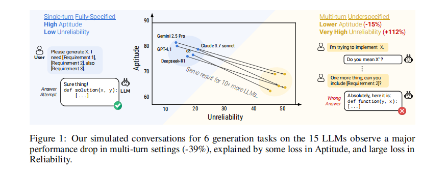
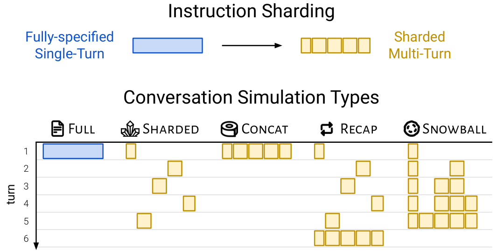
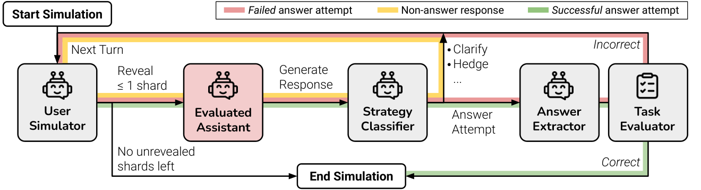

# LLMs Get Lost In Multi-Turn Conversation

ICLR 2026，**Outstanding Paper**
[原文](https://arxiv.org/abs/2505.06120)

Kruglanski 与 Webster 在 1996 年提出：人有时会强烈希望“赶快得到一个确定答案”，其过程分为两步：
- **抓取（Seizing）**：信息还不足，就抓住最先出现的合理解释，结束不确定状态。
- **冻结（Freezing）**：解释一旦成为主观上确定的结论，就不愿重新打开问题，对后续证据的调整不足。

> 这篇论文描述的现象大概是LLM在多轮交互过程中不断获得信息碎片，最终成效会低于一开始就得到完整信息。这似乎是一个很直观的结论：模型作为一个需要交付产品的老牛马，一开始只被甲方告知部分需求，他满足这部分需求之后仔细补充了其他设定，这样已经完成了一个产品，后续甲方又补充其他需求，模型就在之前的交付上修改，由于之前补充的设定可能偏离了后面的需求，在改的过程中就不如推倒重写。

## 核心贡献

- **设计了一种公平测法**：把同一份完整需求拆成多轮给出，对比一次性给全，测的是同一件事能否完成。
- **发现主要短板是“不稳定”**：模型往往有能力解决任务，但交互中走错一步，后面就容易纠不回来。
- **找到一些行为线索**：过早交卷、自行补设定、依赖旧答案不断打补丁；最后重述完整需求，也只能部分挽救。

这篇文章的重要贡献在于**把一个直觉问题做成系统评测、量化其严重性**。

## 实验设计

如果让我来设计验证的话，自然会想到的就是类似于一段完整需求的文本以及将完整需求的文本拆成多段文本（用AI拆解，保障逻辑和连贯性）。仔细想想还挺麻烦的：原始任务和需求从哪里采样比较有说服力，怎样排除上下文长度不同产生的影响，需求之间的原子性（指LLM自己不容易联想到）会不会影响实验现象，要不要考虑多轮交互过程中LLM给的反馈（按理来说正常使用过程中会根据反馈调整之后的提示词？）

### 妙妙点一：拆完再拼回去，多加一个对照，堵住一个关键质疑

|设置|怎么给需求|检查什么|
|---|---|---|
|Full|原始完整需求一次给完|基准表现|
|Concat|拆出的碎片重新拼在一起，一次给完|拆分改写是否损伤题意|
|Sharded|每轮给一个新碎片|分批交互造成多少下降|
|Recap|分批交互后，最后重述全部需求|最后提醒一次能否挽救|
|Snowball|每轮都重复此前全部需求|持续提醒能否挽救|

如果只比较 Full 和 Sharded，审稿人可以质疑：“是不是你拆题时把题目改坏了？”把同样的碎片拼回去，就能检查这个替代解释。

### 妙妙点二： 让“模拟甲方”知道全部需求，让被测模型逐步获知

- **User Simulator**：掌握完整需求，根据对话挑选下一条要披露的碎片。
- **Assistant**：被测模型，可以自由回答或追问。
- **右侧评估流程**：先判断是否提交了答案，再提取答案并评分

模型追问某个条件时，模拟用户能够选择相关碎片回应，而不是机械地照固定剧本往下念；同时，把“澄清问题”和“正式交卷”区分开，避免混在一起评分。

> 不过我的疑问好像没有被解决（）

## 关键结论

1. **下降广泛存在。** 在测试的15个模型、6类任务中，多轮设置的平均表现相对下降约39%；单轮能力强的模型也会明显退化。

2. **主要问题是发挥不稳定。** 模型在某些对话轨迹中能做对，在另一些轨迹中却严重失败。按论文指标，较好情况下的表现平均下降约16%，不可靠性增加约112%。

3. **早期答案容易成为后续包袱。** 模型在需求不完整时补设定、提前交卷，随后依赖旧答案修改，难以撤销原先的错误假设；答案也越改越臃肿。

4. **常见补救只能部分改善。** 重述全部需求、每轮重复已有需求，都没恢复到一次性给全的水平；降低温度也没有解决多轮不稳定问题。

5. **两轮就可能出现，不必等到长对话。** 逐步拆分实验发现，将需求分成两轮提供，就已经能观察到明显退化。

## Think

- 智能体长程任务是一个天然的多轮交互过程，也有文章表明长程任务容易忽略用户的部分需求，是否与智能体在了解足够信息之前就决策确定方向有关？
- 有没有什么操作能让AI更有耐心？一个理想的长程交互应该是先搜集足够信息再决策敲定方向
- 按照实验结果，如果AI推倒重写可能会达到更好的效果，延续之前的实现，只进行修补，这种惰性能否被修正？
